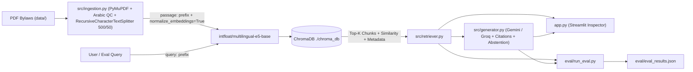
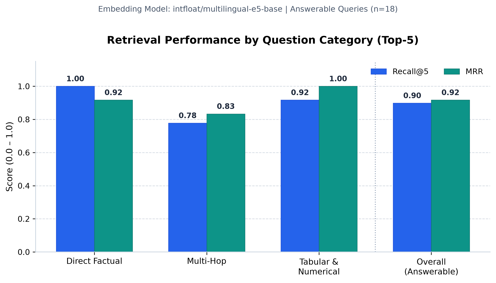
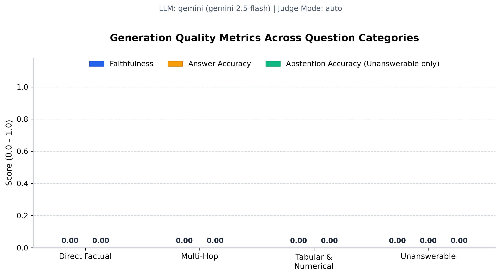
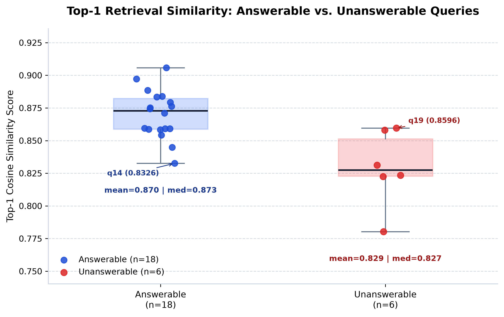

# Helwan National University — RAG Question-Answering & Evaluation

A clean, modular Retrieval-Augmented Generation (RAG) and evaluation repository built for the **Helwan National University (Faculty of Computer Science & Information Technology — Robotics Software Program)** internal bylaws PDF (`data/`), handling mixed Arabic text, English course titles/codes, and regulatory tables.

---

## Project Structure

```text
helwan-rag-qa-eval/
├── data/                   # Source regulation PDF(s) (bilingual Arabic/English)
├── src/
│   ├── __init__.py         # Shared defaults & constants
│   ├── ingestion.py        # PDF loading, Arabic quality warnings, chunking, ChromaDB persistence
│   ├── retriever.py        # Query embedding (multilingual-e5-base) & ChromaDB retrieval
│   └── generator.py        # Grounded LLM generation (Gemini / Groq), citations & abstention
├── eval/
│   ├── test_dataset.json   # 24-question verified benchmark across 4 categories
│   ├── run_eval.py         # Recall@K, MRR, faithfulness, answer accuracy & JSON report
│   ├── generate_plots.py   # 300-DPI matplotlib visualization generator
│   ├── eval_results.json   # Latest persisted evaluation output
│   └── plots/              # Generated evaluation charts (PNG)
├── tests/
│   └── test_pipeline.py    # Offline pytest suite (chunking, metadata, retrieval, citations)
├── app.py                  # Streamlit UI for answer, citations, and chunk score inspection
├── pyproject.toml          # pytest and ruff configuration
├── requirements.txt        # Python dependencies
└── .gitignore
```

---

## Architecture Overview



### Key Design Choices
- **Bilingual Arabic/English Embeddings**: Uses `intfloat/multilingual-e5-base` with `normalize_embeddings=True` and task prefixes (`passage: ` during indexing, `query: ` during retrieval).
- **Colloquial & Academic-Level Query Expansion**: `normalize_and_expand_query` in [`src/retriever.py`](src/retriever.py) keeps the user's original query intact while appending canonical bylaws terms for colloquial Egyptian phrasing (e.g., `"سنه 3"` / `"سنه تالته"` → `"المستوى الثالث"`, `"الفرقة الثالثة"`, `"المقررات الدراسية"`), summer-term/prerequisite phrasing, and Arabic-to-Latin course prefix aliases (`بنل`/`حسب`/`أسس`/`عام` → `ROB`/`COM`/`BAS`/`GEN` and `مقرر المشروع` ↔ `COM 400` / `COM 498`).
- **Diversity-Aware Multi-Page Retrieval**: `ChromaRetriever.retrieve` supports wider candidate pooling (`fetch_k`) and per-page capping (`max_per_page=2` by default, with ascending-distance backfill) so repeated high-density pages (such as `CGPA` or course-description prose) do not crowd out prerequisite tables or scattered regulatory articles.
- **Arabic PDF Quality Guardrails & Metadata Cues**: [`src/ingestion.py`](src/ingestion.py) reconstructs visual-to-logical reading order from PyMuPDF glyph bounding boxes (`rawdict`), preserving RTL Arabic words alongside embedded LTR course codes/numbers, flags reversed/corrupted extraction, and attaches optional scalar ChromaDB metadata (`course_codes`, `articles`, `academic_level`, `chunk_type`).
- **Strict Grounding & Abstention**: [`src/generator.py`](src/generator.py) forces inline `[صفحة X]` / `[Page X]` citations linked back to retrieved chunk metadata and abstains verbatim when retrieved context does not support an answer.
- **Session-Only UI Controls & Warm Cache**: [`app.py`](app.py) pre-warms `get_embedding_model` inside `@st.cache_resource`, defaults `top_k` to `8`, displays enriched metadata cues and expanded queries, and supports session-only (`st.session_state`, never written to disk or `.env`) provider/model/API-key overrides alongside environment credentials (`GEMINI_API_KEY` / `GROQ_API_KEY`).

---

## Setup & Usage

### 1. Environment & Dependencies

```powershell
python -m venv .venv
.venv\Scripts\Activate.ps1
pip install -r requirements.txt
```

### 2. Configure API Keys (`.env`)

Create a `.env` file in the project root (ignored by `.gitignore`):

```dotenv
# Choose "gemini" or "groq" (auto-detected if omitted)
LLM_PROVIDER=gemini

GEMINI_API_KEY=your_gemini_api_key_here
GEMINI_MODEL=gemini-2.5-flash

# Or use Groq:
# LLM_PROVIDER=groq
# GROQ_API_KEY=your_groq_api_key_here
# GROQ_MODEL=llama-3.3-70b-versatile
```

### 3. Ingest PDFs into `./chroma_db`

```bash
python -m src.ingestion --samples 5
```

### 4. Launch the Streamlit Inspection UI

```bash
streamlit run app.py
```

### 5. Run Evaluation

```bash
# Retrieval-only evaluation (no API key required):
python -m eval.run_eval --retrieval-only --top-k 5

# Full end-to-end evaluation (Retrieval + Grounded Generation + Judge):
python -m eval.run_eval --top-k 5 --provider gemini

# Generate evaluation plots from eval/eval_results.json:
python -m eval.generate_plots
```

Results are saved to `eval/eval_results.json` and charts to `eval/plots/`.

### 6. Linting & Tests

```bash
ruff check .
pytest -v
```

---

## Evaluation Metrics

Observed results from [`eval/eval_results.json`](eval/eval_results.json) (`top_k = 5`, embedding model `intfloat/multilingual-e5-base`, configured LLM `gemini` / `gemini-2.5-flash`, `judge_mode = auto`, `24` questions across 4 categories):

> **Observed Generation API Status:** During the end-to-end run, all 24 generation calls to the configured `gemini-2.5-flash` endpoint returned HTTP `404 NOT_FOUND` (`"This model models/gemini-2.5-flash is no longer available to new users"`), resulting in `0.0000` across generation/judge metrics while all retrieval metrics completed cleanly across all 24 queries. No values were fabricated or interpolated.

### Overall Summary (`top_k = 5`)

| Metric | Value | Notes |
| --- | --- | --- |
| `Recall@5` | `0.8981` | Answerable queries (`n = 18`) |
| `MRR` | `0.9167` | Mean Reciprocal Rank across answerable queries (`n = 18`) |
| `Faithfulness` | `0.0000` | `0/24` generated (`404 NOT_FOUND` on `models/gemini-2.5-flash`) |
| `Answer Accuracy` | `0.0000` | `0/24` generated (`404 NOT_FOUND` on `models/gemini-2.5-flash`) |
| `Citation Quality` | `0.0000` | `0/24` generated (`404 NOT_FOUND` on `models/gemini-2.5-flash`) |
| `Abstention Accuracy` | `0.0000` | `0/6` generated (`404 NOT_FOUND` on `models/gemini-2.5-flash`) |

### Breakdown by Question Category

| Category | Count | `Recall@5` | `MRR` | `Faithfulness` | `Answer Accuracy` | `Citation Quality` | `Abstention Acc` |
| --- | --- | --- | --- | --- | --- | --- | --- |
| `direct_factual` | 6 | `1.0000` | `0.9167` | `0.0000` | `0.0000` | `0.0000` | N/A |
| `multi_hop` | 6 | `0.7778` | `0.8333` | `0.0000` | `0.0000` | `0.0000` | N/A |
| `tabular_numerical` | 6 | `0.9167` | `1.0000` | `0.0000` | `0.0000` | `0.0000` | N/A |
| `unanswerable` | 6 | N/A | N/A | `0.0000` | `0.0000` | `0.0000` | `0.0000` |

---

## Failure Analysis Examples

Concrete failure and degradation cases observed directly in [`eval/eval_results.json`](eval/eval_results.json) and `./chroma_db`:

1. **Multi-Hop Prerequisite Chain Drift (`q10` — `multi_hop`)**
   - **Question:** `"ما سلسلة المتطلبات السابقة الكاملة للوصول إلى مقرر الروبوتات المتنقلة (ROB 404) بدءاً من مقررات العلوم الأساسية والكلية؟"`
   - **Observed Behavior:** `Recall@5 = 0.0000`, `MRR = 0.0000`. Top-5 retrieved pages were `[46, 44, 3, 46, 47]` (`p046::c001` sim=`0.8751`, `p044::c003` sim=`0.8563`, `p003::c006` sim=`0.8540`), completely missing the prerequisite tables on pages `16` and `18`.
   - **Technical Root Cause:** Semantic drift toward the narrative course description of `ROB 404` on page 46 (which repeats `"الروبوتات المتنقلة"` and `"ROB 404"`), combined with single-pass dense retrieval's inability to traverse chained prerequisite hops (`ROB 404` → `ROB 401` → `ROB 303` → `COM 104`/`COM 201` → `BAS 102`) across separate curriculum tables.
   - **Mitigation:** Parse Article 26 curriculum tables into structured prerequisite rows (repeating headers per row) or a course-prerequisite graph, and add iterative/multi-hop query expansion.

2. **Scattered Multi-Article Recall Loss & Near-Duplicate Crowding (`q07` — `multi_hop`)**
   - **Question:** `"طالب معدله التراكمي CGPA في بداية الفصل الدراسي يساوي 1.8، ما الحد الأقصى للساعات المعتمدة التي يمكنه تسجيلها، وهل يُوجه له إنذار أكاديمي، وما قواعد إعادة المقررات التي سبق نجاحه فيها لرفع معدله؟"`
   - **Observed Behavior:** `Recall@5 = 0.6667`, `MRR = 1.0000`. Top-5 retrieved pages `[11, 10, 12, 10, 7]` (`p011::c006` sim=`0.8839`, `p010::c005` sim=`0.8776`, `p012::c002` sim=`0.8690`, `p010::c004` sim=`0.8685`, `p007::c006` sim=`0.8674`) missed **page 9** (Article 17 academic warning & 4-semester dismissal rule), and retrieved `p007::c006` (course withdrawal) instead of `p007::c003` (the 15-credit load tier).
   - **Technical Root Cause:** High-frequency `CGPA` chunks on pages 10–12 monopolized 4 of the 5 slots, crowding out Article 17 (`p.9`) and the specific credit-tier chunk (`p007::c003`).
   - **Mitigation:** Decompose compound multi-hop queries into sub-queries, enforce per-article/per-page MMR diversification, and apply cross-encoder reranking over a wider candidate pool (`top_k = 15 → 5`).

3. **Cross-Article Grading Table & Alias Mismatch (`q17` — `tabular_numerical`)**
   - **Question:** `"كم عدد الساعات المعتمدة وساعات العملي لمقرري مشروع التخرج (COM 400 و COM 498)، وما متطلبهما السابق، وكيف تُوزع درجات مقرر المشروع؟"`
   - **Observed Behavior:** `Recall@5 = 0.5000`, `MRR = 1.0000`. Top-5 retrieved pages `[19, 12, 12, 7, 13]` (`p019::c003` sim=`0.8592` at rank 1, followed by `p012::c005` sim=`0.8540` and `p012::c004` sim=`0.8395`) missed **page 9** (`p009::c005`, Article 18: 50% coursework / 50% oral defense). *(Similarly, on `q06`, `p044::c003` at `0.8594` outranked `p046::c001` at `0.8583`, lowering `MRR` to `0.5000`.)*
   - **Technical Root Cause:** Article 18 (`p.9`) refers to `"مقرر المشروع"` without the course codes `COM 400` / `COM 498`, whereas credit-hour terminology attracts Article 22 (`p.12`) and Article 25 (`p.13`).
   - **Mitigation:** Enrich table/article chunks with entity aliases (linking `"مقرر المشروع"` with `COM 400` / `COM 498`) and combine BM25 exact-code matching with dense E5 retrieval.

4. **High Cosine Similarity on Unanswerable Queries & Retired Model API Error (`q19`, `q23` — `unanswerable`)**
   - **Observed Behavior:** Unanswerable queries still scored high Top-1 cosine similarities (`mean = 0.829`, `median = 0.827`, max `0.8596` on `q19` and `0.8581` on `q20`), substantially overlapping answerable queries (`mean = 0.870`, `min = 0.8326` on `q14`). For example, `q19` (tuition amount in EGP) matched `p012::c003` at `0.8596` via `"يدفع الطالب مقابل إعادة المقرر"`, and `q23` (exact academic calendar dates) matched `p006::c005` at `0.8235`. Meanwhile, generation failed across all 24 queries (`method = "error"`) because `models/gemini-2.5-flash` returned `404 NOT_FOUND`.
   - **Technical Root Cause:** Multilingual dense embeddings capture topical overlap (fees, dates, coordinator roles) even when the exact requested facts (EGP amounts, calendar dates, individual names) do not exist in the corpus—making a static `min_similarity` threshold ineffective.
   - **Mitigation:** Keep abstention driven by strict LLM context verification (and NLI/answerability gating) rather than cosine thresholds alone, and configure an active provider/model in `.env` (e.g., an active Gemini model or `LLM_PROVIDER=groq`) before re-running `eval.run_eval`.

- **Baseline Snapshot & Implemented Mitigations**: The metrics above capture the baseline `top_k = 5` run prior to adding query expansion, `max_per_page = 2` diversity pooling, and course/article/level metadata extraction in `src/retriever.py` / `src/ingestion.py` (with `app.py` now defaulting `top_k = 8`). Full prerequisite-graph parsing and cross-encoder reranking remain future enhancements.

---

## Plots & Visualizations

Generated directly from [`eval/eval_results.json`](eval/eval_results.json) via `python -m eval.generate_plots`:

### 1. Retrieval Performance by Question Category (`Top-5`)


### 2. Generation Quality Metrics Across Categories


### 3. Top-1 Cosine Similarity Distribution (Answerable vs. Unanswerable)

