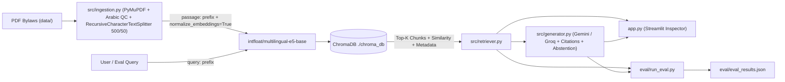

# Helwan National University — RAG Question-Answering & Evaluation

A clean, modular Retrieval-Augmented Generation (RAG) and evaluation repository built for the **Helwan National University (Faculty of Computer Science & Information Technology — Robotics Software Program)** internal bylaws PDF (`data/`), handling mixed Arabic text, English course titles/codes, and regulatory tables.

---

## Project Structure

```text
helwan-rag-qa-eval/
├── data/                   # Source regulation PDF(s) (bilingual Arabic/English)
├── src/
│   ├── __init__.py         # Shared defaults & constants
│   ├── ingestion.py        # PDF loading, Arabic quality warnings, chunking, ChromaDB persistence
│   ├── retriever.py        # Query embedding (multilingual-e5-base) & ChromaDB retrieval
│   └── generator.py        # Grounded LLM generation (Gemini / Groq), citations & abstention
├── eval/
│   ├── test_dataset.json   # 24-question starter benchmark across 4 categories
│   └── run_eval.py         # Recall@K, MRR, faithfulness, answer accuracy & JSON report
├── tests/
│   └── test_pipeline.py    # Offline pytest suite (chunking, metadata, retrieval, citations)
├── app.py                  # Streamlit UI for answer, citations, and chunk score inspection
├── pyproject.toml          # pytest and ruff configuration
├── requirements.txt        # Python dependencies
└── .gitignore
```

---

## Architecture Overview



### Key Design Choices
- **Bilingual Arabic/English Embeddings**: Uses `intfloat/multilingual-e5-base` with `normalize_embeddings=True` and task prefixes (`passage: ` during indexing, `query: ` during retrieval).
- **Arabic PDF Quality Guardrails**: `src/ingestion.py` reconstructs visual-to-logical reading order from PyMuPDF glyph bounding boxes (`rawdict`), preserving RTL Arabic words (including MS Word zero-width Lam-Alef ligature tie-breaking) alongside embedded LTR English course codes and numbers, and emits explicit diagnostics if reversed Arabic tokens, presentation forms, or replacement characters (`U+FFFD`) appear.
- **Strict Grounding & Abstention**: `src/generator.py` forces inline `[صفحة X]` / `[Page X]` citations linked back to retrieved chunk metadata and abstains verbatim when retrieved context does not support an answer.
- **Environment-Only Credentials**: Zero hardcoded keys. Supports Gemini (`GEMINI_API_KEY`) or Groq (`GROQ_API_KEY`) via `.env` or shell environment variables.

---

## Setup & Usage

### 1. Environment & Dependencies

```powershell
python -m venv .venv
.venv\Scripts\Activate.ps1
pip install -r requirements.txt
```

### 2. Configure API Keys (`.env`)

Create a `.env` file in the project root (ignored by `.gitignore`):

```dotenv
# Choose "gemini" or "groq" (auto-detected if omitted)
LLM_PROVIDER=gemini

GEMINI_API_KEY=your_gemini_api_key_here
GEMINI_MODEL=gemini-2.5-flash

# Or use Groq:
# LLM_PROVIDER=groq
# GROQ_API_KEY=your_groq_api_key_here
# GROQ_MODEL=llama-3.3-70b-versatile
```

### 3. Ingest PDFs into `./chroma_db`

```bash
python -m src.ingestion --samples 5
```

### 4. Launch the Streamlit Inspection UI

```bash
streamlit run app.py
```

### 5. Run Evaluation

```bash
# Retrieval-only evaluation (no API key required):
python -m eval.run_eval --retrieval-only --top-k 5

# Full end-to-end evaluation (Retrieval + Grounded Generation + Judge):
python -m eval.run_eval --top-k 5 --provider gemini
```

Results are saved to `eval/eval_results.json`.

### 6. Linting & Tests

```bash
ruff check .
pytest -v
```

---

## Evaluation Metrics (Placeholder)

> Verify `eval/test_dataset.json` against your target rubric, run `python -m eval.run_eval`, and record observed metrics from `eval/eval_results.json` below.

### Overall Summary (`top_k = 5`)

| Metric | Value | Notes |
| --- | --- | --- |
| `Recall@5` | _TBD_ | Answerable queries (`n = 18`) |
| `MRR` | _TBD_ | Mean Reciprocal Rank across answerable queries |
| `Faithfulness` | _TBD_ | LLM-as-a-judge / structured rubric |
| `Answer Accuracy` | _TBD_ | Reference alignment across answerable + unanswerable queries |
| `Abstention Accuracy` | _TBD_ | Correct refusal on unanswerable queries (`n = 6`) |

### Breakdown by Question Category

| Category | Count | `Recall@5` | `MRR` | `Faithfulness` | `Answer Accuracy` | `Abstention Acc` |
| --- | --- | --- | --- | --- | --- | --- |
| `direct_factual` | 6 | _TBD_ | _TBD_ | _TBD_ | _TBD_ | N/A |
| `multi_hop` | 6 | _TBD_ | _TBD_ | _TBD_ | _TBD_ | N/A |
| `tabular_numerical` | 6 | _TBD_ | _TBD_ | _TBD_ | _TBD_ | N/A |
| `unanswerable` | 6 | N/A | N/A | _TBD_ | _TBD_ | _TBD_ |

---

## Failure Analysis Examples (Placeholder)

Document concrete failure cases discovered using `app.py` and `eval/eval_results.json`:

1. **Multi-hop Prerequisite Chains (`multi_hop`)**
   - *Query ID*: `q10` (prerequisite chain for `ROB 404`)
   - *Observed Issue*: _Placeholder — e.g., top-5 chunks retrieve page 18 (`ROB 404` -> `ROB 401`) but miss earlier faculty/basic-science rows on page 16._
   - *Mitigation Idea*: _Increase `top_k`, add parent-table or neighbor-chunk expansion, or extract structured prerequisite metadata._

2. **Tabular Row Boundary Splitting (`tabular_numerical`)**
   - *Query ID*: `q13` / `q14`
   - *Observed Issue*: _Placeholder — 500-character chunking splits wide PDF tables across chunks without repeating column headers._
   - *Mitigation Idea*: _Pre-extract PDF tables as Markdown tables with repeated headers before chunking._

3. **Arabic Ligature / CMap Artifacts**
   - *Observed Issue*: _Placeholder — Microsoft Word PDF CMap emits `الالئحة` / `خالل` alongside standard Arabic spellings, reducing lexical/embedding alignment._
   - *Mitigation Idea*: _Expand Arabic normalization dictionary in `src/ingestion.py` or compare `pdfplumber` / `pymupdf4llm`._

4. **Abstention Calibration (`unanswerable`)**
   - *Query ID*: `q23` (specific academic calendar dates)
   - *Observed Issue*: _Placeholder — Article 5 mentions "مواعيد الدراسة والقيد", causing high cosine similarity even though exact calendar dates are absent._
   - *Mitigation Idea*: _Tune `min_similarity` threshold or strengthen abstention verification._

---

## Plots & Visualizations (Placeholder)

Add charts generated from `eval/eval_results.json` (for example under `eval/plots/`):

- `` *(placeholder)*
- `` *(placeholder)*
- `` *(placeholder)*
